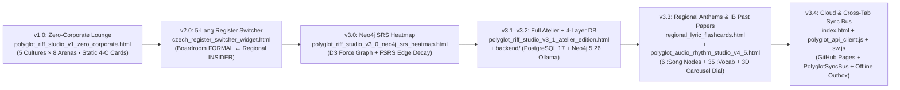

# Polyglot Interpersonal Riff Studio — Codebase Lineage, Single Source of Truth (SSOT) & File Map (`v3.4.0`)

> [!IMPORTANT]
> **Read This First in Any Future Session**
> Because the project evolved rapidly across multiple iterations (`v1.0` → `v3.0` → `v3.1` → `v3.3` → `v3.4`) and hosts **6 interactive HTML studio surfaces** alongside a **4-layer database backend**, this document defines the **exact lineage**, **Single Sources of Truth (SSOT)**, **derived vs. canonical files**, and **tech-debt boundaries** so future edits never drift out of sync.

---

## 1. Version Lineage & Evolution Timeline



| Era / Version | Primary Milestone | Canonical Files Introduced | Current Status |
| :--- | :--- | :--- | :--- |
| **`v1.0`** | Zero-Corporate 4-C Lounge (5 regional cultures, 8 social arenas, Spotlight Teleprompter) | [polyglot_riff_studio_v1_zero_corporate.html](file:///C:/Assets/PolyglotSales/polyglot_riff_studio_v1_zero_corporate.html) | **Active Tab 6** in Suite Hub (upgraded with 3D Carousel Dial & `PolyglotSyncBus`) |
| **`v2.0`** | 5-Language Formal ↔ Regional Register Switcher (`CZ_STD ↔ CZ_OVA`, etc.) | [czech_register_switcher_widget.html](file:///C:/Assets/PolyglotSales/czech_register_switcher_widget.html) | **Active Tab 4** in Suite Hub (upgraded with IB `:Vocab` Explorer & 3D Carousel Dial) |
| **`v3.0`** | Neo4j Property Graph & FSRS Memory Decay Heatmap ($R(t) = (1 + \frac{t}{9 \cdot S})^{-1}$) | [polyglot_riff_studio_v3_0_neo4j_srs_heatmap.html](file:///C:/Assets/PolyglotSales/polyglot_riff_studio_v3_0_neo4j_srs_heatmap.html), [fsrs_edge_retrievability_engine.js](file:///C:/Assets/PolyglotSales/fsrs_edge_retrievability_engine.js) | **Active Tab 5** in Suite Hub (connected to `PolyglotSyncBus`) |
| **`v3.1–v3.2`** | Full Atelier Workbench + 4-Layer Backend (PostgreSQL 17 `pgvector`, Neo4j 5.26 `APOC`, FastAPI `:8765`, Ollama `gemma4:12b` & `bge-m3`) | [polyglot_riff_studio_v3_1_atelier_edition.html](file:///C:/Assets/PolyglotSales/polyglot_riff_studio_v3_1_atelier_edition.html), `backend/**`, `db/*.db.json` | **Active Tab 3 (Default Hub View)** + **Canonical Backend** |
| **`v3.3`** | 6 Regional & Global Song Anthems (`:Song`), 35 IB Past-Paper `:Vocab` nodes, `:FALSE_FRIEND_ALERT`, Tone.js Beat Engine, Shrunk 3D Rotating Carousel Dial (`~142px × 28px`) | [regional_lyric_flashcards.html](file:///C:/Assets/PolyglotSales/regional_lyric_flashcards.html), [polyglot_audio_rhythm_studio_v4_5.html](file:///C:/Assets/PolyglotSales/polyglot_audio_rhythm_studio_v4_5.html), [polyglot-srs-cypher-migration.cypher](file:///C:/Assets/PolyglotSales/polyglot-srs-cypher-migration.cypher) | **Active Tabs 1 & 2** in Suite Hub |
| **`v3.4`** | Mobile-Friendly Web Hub, Cross-Tab `PolyglotSyncBus`, Offline Client Outbox, & GitHub Pages Static Cloud Hosting | [index.html](file:///C:/Assets/PolyglotSales/index.html), [polyglot_api_client.js](file:///C:/Assets/PolyglotSales/polyglot_api_client.js), [sw.js](file:///C:/Assets/PolyglotSales/sw.js), [manifest.webmanifest](file:///C:/Assets/PolyglotSales/manifest.webmanifest), [publish_github_pages.ps1](file:///C:/Assets/PolyglotSales/publish_github_pages.ps1) | **Canonical Entrypoint & Cloud Deployment** |

---

## 2. Single Source of Truth (SSOT) Rules — Where to Edit What

> [!WARNING]
> **Golden Rule for Future Edits: Never Hand-Edit Derived Shards (`db/*.db.json`) or Backup Dumps (`backups/*`)**
> The 6 files in `db/*.db.json` (`cz_ova.db.json`, `at_vie.db.json`, `ru_ala.db.json`, `en_yyc.db.json`, `es_sot.db.json`, `polyglot_fabric.db.json`) are **automatically generated** by [backend/services/sync_service.py](file:///C:/Assets/PolyglotSales/backend/services/sync_service.py) during `python -m backend.cli seed` or `python -m backend.cli export-shards`. Hand-editing `db/*.db.json` will be overwritten on the next sync!

| If You Want To Add or Modify... | Canonical Source File(s) to Edit | Command to Propagate Across All 4 Layers & GitHub Pages |
| :--- | :--- | :--- |
| **Core 4-C Cards, Personas/Registers, Idioms, Bridges, Room States, or False Friends** | [backend/seed/corpus_data.py](file:///C:/Assets/PolyglotSales/backend/seed/corpus_data.py) and [backend/seed/arena_decks_8.py](file:///C:/Assets/PolyglotSales/backend/seed/arena_decks_8.py) | `.\.venv\Scripts\python.exe -m backend.cli seed --no-embed` |
| **IB Past-Paper `:Vocab`, `:FALSE_FRIEND_ALERT` Edges, or Regional `:Song` Anthems** | [backend/seed/ib_vocab_data.py](file:///C:/Assets/PolyglotSales/backend/seed/ib_vocab_data.py) | `.\.venv\Scripts\python.exe -m backend.cli seed --no-embed` |
| **PostgreSQL Table Columns or Indexes** | [backend/db/postgres.py](file:///C:/Assets/PolyglotSales/backend/db/postgres.py) (`SCHEMA_VERSION` + DDL) | `.\.venv\Scripts\python.exe -m backend.cli seed --no-embed` |
| **Neo4j Uniqueness Constraints or Outbox Cypher Projection** | [backend/db/neo4j_client.py](file:///C:/Assets/PolyglotSales/backend/db/neo4j_client.py) and [backend/services/sync_service.py](file:///C:/Assets/PolyglotSales/backend/services/sync_service.py) | `.\.venv\Scripts\python.exe -m backend.cli sync --force` |
| **Browser API Calls, Offline Shard Fallback, Cross-Tab Culture Sync, or Mobile Touch/Swipe** | [polyglot_api_client.js](file:///C:/Assets/PolyglotSales/polyglot_api_client.js) (`window.PolyglotAPI`, `window.PolyglotSyncBus`, `window.PolyglotMobile`) | Refresh browser (or bump `CACHE_NAME` in [sw.js](file:///C:/Assets/PolyglotSales/sw.js)) |
| **Suite Navigation Bar, Mobile Bottom Dock, or LAN/Offline Sync Modal** | [index.html](file:///C:/Assets/PolyglotSales/index.html) | Refresh `index.html` or run `.\publish_github_pages.ps1` |

---

## 3. Complete Directory & File Map

### A. Root Entrypoints, PWA & Launch Scripts
| File | Role & Responsibility | Classification |
| :--- | :--- | :--- |
| [index.html](file:///C:/Assets/PolyglotSales/index.html) | **Master Suite Hub Launcher**: Top desktop tab bar, mobile bottom thumb dock (`<768px`), Global Culture Sync Bar (`🇨🇿 🇦🇹 🇰🇿 🇨🇦 🇪🇸`), and 🌐 Mobile/Offline Outbox Sync modal. | **CANONICAL ENTRYPOINT** |
| [polyglot_api_client.js](file:///C:/Assets/PolyglotSales/polyglot_api_client.js) | **Unified Browser SDK (`v3.4`)**: Provides `window.PolyglotAPI` (REST + instant GitHub Pages `.db.json` shard assembler + `localStorage` outbox queue), `window.PolyglotSyncBus` (cross-tab culture sync), and `window.PolyglotMobile` (Tone.js unlock + swipe + haptics). | **CANONICAL SDK** |
| [manifest.webmanifest](file:///C:/Assets/PolyglotSales/manifest.webmanifest) | Web App Manifest for standalone mobile/desktop browser installation. | **CANONICAL PWA** |
| [sw.js](file:///C:/Assets/PolyglotSales/sw.js) | Offline-first Service Worker caching all 6 HTML studio views, `polyglot_api_client.js`, and all 6 `db/*.db.json` shards. | **CANONICAL PWA** |
| [start_polyglot_stack.ps1](file:///C:/Assets/PolyglotSales/start_polyglot_stack.ps1) | 1-click local full-stack launcher (starts WSL2/Windows Docker Postgres `:5433` + Neo4j `:7687`, seeds DB, starts FastAPI on `0.0.0.0:8765`, and prints the Wi-Fi LAN URL). | **CANONICAL SCRIPT** |
| [launch_studio.cmd](file:///C:/Assets/PolyglotSales/launch_studio.cmd) | Double-click Windows wrapper that invokes `start_polyglot_stack.ps1`. | **CANONICAL SCRIPT** |
| [publish_github_pages.ps1](file:///C:/Assets/PolyglotSales/publish_github_pages.ps1) | Exports deterministic `db/*.db.json` shards, commits changes, and pushes to `origin/main` to trigger GitHub Pages deployment. | **CANONICAL SCRIPT** |
| [docker-compose.yml](file:///C:/Assets/PolyglotSales/docker-compose.yml) | Container definitions for `polyglot-neo4j` (`neo4j:5.26-community` + APOC on `:7474`/`:7687`) and `polyglot-postgres` (`pgvector/pgvector:pg17` on `:5433`). | **CANONICAL INFRA** |

---

### B. The 6 Interactive HTML Studio Views (Hosted Inside `index.html`)
All 6 HTML views load [polyglot_api_client.js](file:///C:/Assets/PolyglotSales/polyglot_api_client.js) and synchronize their active language via `window.PolyglotSyncBus`:

| Tab # in `index.html` | File | Unique Capabilities | Tech-Debt Note |
| :---: | :--- | :--- | :--- |
| **Tab 1** (`🎵 Anthems`) | [regional_lyric_flashcards.html](file:///C:/Assets/PolyglotSales/regional_lyric_flashcards.html) | 3D flip flashcards for all **6 Regional & Global Anthems** (*Nohavica*, *Falco*, *A-Studio*, *Loverboy*, *Camarón*, *The Weeknd*), 5-language lyric translations, 4-C code-switching pivot lines, Tone.js BPM beat generator, and live 1–5 FSRS grading bar. | Hydrates live FSRS edge stability via `PolyglotAPI` with embedded 6-anthem fallback. |
| **Tab 2** (`🎛️ Rhythm v4.5`) | [polyglot_audio_rhythm_studio_v4_5.html](file:///C:/Assets/PolyglotSales/polyglot_audio_rhythm_studio_v4_5.html) | Neon-Noir 6-subtab studio: 16-step Tone.js rhythm sequencer, 4-C Studio & SRS Grader, 6-Anthem Lyric Lab, Chameleon Roulette, D3 Force Graph, Trilingual False-Friend 60s Blitz Drill, and Fullscreen Teleprompter. | Connected to `PolyglotAPI` for FSRS grading, custom card commits, and 6-song hydration. |
| **Tab 3** (`★ Atelier v3.1`) | [polyglot_riff_studio_v3_1_atelier_edition.html](file:///C:/Assets/PolyglotSales/polyglot_riff_studio_v3_1_atelier_edition.html) | **Primary Full-Engine Workbench**: 8 Social Arenas, Live Ollama (`gemma4:12b`/`gemma3:4b`) Thought-to-Riff Stylizer, Trilingual Lexical Scaffolder, IB Past-Paper `:Vocab` Explorer, Regional Newspaper Webhook Approval Queue, and Shrunk 3D Rotating Carousel Dial. | Most comprehensive single-page studio (`~6,700` lines); hydrates from `/api/v1/state/full` or `db/*.db.json`. |
| **Tab 4** (`⇄ 5-Lang Switcher`) | [czech_register_switcher_widget.html](file:///C:/Assets/PolyglotSales/czech_register_switcher_widget.html) | Side-by-side **Formal Executive (`*_STD`) ↔ Regional Insider (`*_OVA/VIE/ALA/YYC/SOT`)** register switcher across all 5 languages, acoustic pitch-drop cues, IB `:Vocab` & `:FALSE_FRIEND_ALERT` cards, and 3D Rotating Carousel Dial. | Filename says `czech_` for historical reasons (`v2.0`), but supports all 5 languages (`CS`, `DE`, `RU`, `EN`, `ES`). |
| **Tab 5** (`🔥 SRS Map v3.0`) | [polyglot_riff_studio_v3_0_neo4j_srs_heatmap.html](file:///C:/Assets/PolyglotSales/polyglot_riff_studio_v3_0_neo4j_srs_heatmap.html) | Dedicated D3.js Force-Directed Graph & Etymological Cousin (`:SHARES_VIBE_WITH`) Explorer with `:State` objection simulation and Rust decay simulator. | Retained as a focused graph-inspection view alongside Atelier v3.1. |
| **Tab 6** (`🍷 Lounge v1.0`) | [polyglot_riff_studio_v1_zero_corporate.html](file:///C:/Assets/PolyglotSales/polyglot_riff_studio_v1_zero_corporate.html) | High-contrast Zero-Corporate reading lounge for pure monologue rehearsal across all 8 social arenas, with Cultural Subtext Glossary and Shrunk 3D Rotating Carousel Dial. | Uses lowercase persona keys (`cz_ova`, `at_vie`, etc.) internally; `PolyglotSyncBus` automatically translates between `CZ_OVA` and `cz_ova`. |

---

### C. Python 4-Layer Backend (`backend/`)
| File | Role & Responsibility |
| :--- | :--- |
| [backend/config.py](file:///C:/Assets/PolyglotSales/backend/config.py) | Environment & port settings (`POSTGRES_HOST_PORT=5433`, `NEO4J_URI=bolt://127.0.0.1:7687`, `API_HOST=0.0.0.0`, `API_PORT=8765`, Ollama models). |
| [backend/cli.py](file:///C:/Assets/PolyglotSales/backend/cli.py) | Typer CLI (`python -m backend.cli {status,seed,sync,audit,backup,export-shards,scaffold,stylize}`). |
| [backend/sdk.py](file:///C:/Assets/PolyglotSales/backend/sdk.py) | High-level async Python SDK (`PolyglotAtelierSDK`) wrapping all backend services. |
| [backend/mcp_server.py](file:///C:/Assets/PolyglotSales/backend/mcp_server.py) | Model Context Protocol (MCP) server exposing Polyglot Riff Studio tools to external AI agents. |
| [backend/api/main.py](file:///C:/Assets/PolyglotSales/backend/api/main.py) | FastAPI application (`v3.3.0`/`v3.4.0`) serving 21 REST endpoints (`/api/v1/*`) + static files. |
| [backend/db/postgres.py](file:///C:/Assets/PolyglotSales/backend/db/postgres.py) | AsyncPG connection pool + idempotent DDL for all **13 PostgreSQL 17 tables** (`languages`, `arenas`, `registers`, `style_lenses`, `idioms`, `idiom_vibe_links`, `cards`, `lexical_scaffolds`, `false_friends`, `room_states`, `bridges`, `graph_edges`, `fsrs_review_events`, `staged_webhooks`, `vocab_items`, `vocab_false_friend_alerts`, `songs`). |
| [backend/db/neo4j_client.py](file:///C:/Assets/PolyglotSales/backend/db/neo4j_client.py) | Async Neo4j 5 Bolt driver + 10 uniqueness constraints (`:Language`, `:Arena`, `:Register`, `:Card`, `:Idiom`, `:Vocab`, `:Song`, `:State`, `:FalseFriend`, `:Bridge`). |
| [backend/seed/corpus_data.py](file:///C:/Assets/PolyglotSales/backend/seed/corpus_data.py) | **SSOT Seed 1**: 5 languages, 10 registers, 6 style lenses, 26 idioms, core terrace cards, bridges, room states, false friends, and staged webhooks. |
| [backend/seed/arena_decks_8.py](file:///C:/Assets/PolyglotSales/backend/seed/arena_decks_8.py) | **SSOT Seed 2**: Full 8-arena × 5-culture × 4-C conversational card decks (bringing total `:Card` count to `196`). |
| [backend/seed/ib_vocab_data.py](file:///C:/Assets/PolyglotSales/backend/seed/ib_vocab_data.py) | **SSOT Seed 3**: `35` IB Past-Paper & regional `:Vocab` items, `4` `:FALSE_FRIEND_ALERT` pairs, and `6` `:Song` Regional/Global Anthems. |
| [backend/seed/run_seed.py](file:///C:/Assets/PolyglotSales/backend/seed/run_seed.py) | Idempotent seeding orchestrator (`seed_all()`) + `bge-m3` (`1024-d`) vector embedding backfill + outbox sync trigger. |
| [backend/services/sync_service.py](file:///C:/Assets/PolyglotSales/backend/services/sync_service.py) | **Core Data Integrity Engine**: Transactional outbox sync (`Postgres -> Neo4j`), orphan pruning, atomic `db/*.db.json` shard writer, 9-point cross-store `audit_data_integrity()`, and SHA-256 `create_backup_snapshot()`. |
| [backend/services/fsrs_service.py](file:///C:/Assets/PolyglotSales/backend/services/fsrs_service.py) | FSRS v4.5 memory decay math ($R(t) = (1 + \frac{t}{9 \cdot S})^{-1}$) and edge transition grading. |
| [backend/services/converse_service.py](file:///C:/Assets/PolyglotSales/backend/services/converse_service.py) | Live Ollama (`gemma4:12b` / `gemma3:4b`) stylizer, semantic `pgvector` retrieval, and ACID card/idiom commit pipeline. |
| [backend/services/bridge_service.py](file:///C:/Assets/PolyglotSales/backend/services/bridge_service.py) | Cross-language pathfinding (`find_bridge_path`), trilingual lexical scaffolding, and Register Switcher deck assembly. |
| [backend/validators/graph_rules.py](file:///C:/Assets/PolyglotSales/backend/validators/graph_rules.py) | Pre-commit validator enforcing the 4-C structure, Myers-Scotton Matrix Language Frame (MLF), and FSRS parameter bounds. |

---

### D. Derived Offline JSON Shards (`db/`) & Cypher Reference Scripts
| File | Status & Lineage |
| :--- | :--- |
| `db/{cz_ova,at_vie,ru_ala,en_yyc,es_sot}.db.json` & `db/polyglot_fabric.db.json` | **DERIVED ARTIFACTS (Tracked in Git for GitHub Pages)**: Auto-generated by `sync_service.py`. Never edit manually; run `python -m backend.cli export-shards` or `seed --no-embed`. |
| [polyglot-srs-cypher-migration.cypher](file:///C:/Assets/PolyglotSales/polyglot-srs-cypher-migration.cypher) | **Canonical Standalone Cypher Script (`v3.3`)**: Self-contained Neo4j Browser / AuraDB script for users running Neo4j without Python/Postgres. |
| `neo4j_seed_*.cypher`, `neo4j_czech_graph_engine.ts`, `fsrs_edge_retrievability_engine.js` | **Historical / Standalone Reference Modules (`v2.0–v3.0`)**: Preserved for NotebookLM Studio reference; superseded at runtime by `backend/services/*` and `polyglot-srs-cypher-migration.cypher`. |

---

## 4. Tech Debt Inventory & Guardrails for Future Work

1. **Embedded Fallback Data in HTML Files vs. `db/*.db.json` Shards**:
   * *Context*: Each of the 6 HTML files contains a built-in JavaScript fallback constant (`DEFAULT_STATE`, `OFFLINE_DECKS`, `ANTHEMS`, `PERSONAS`) so the file can even be opened via `file://` without a web server, and then hydrates live data via `PolyglotAPI` (`fetchFullState()`, `fetchSongs()`, `fetchVocab()`).
   * *Guardrail*: Always add new cards, vocab, or songs to `backend/seed/*.py` and run `python -m backend.cli seed --no-embed` so PostgreSQL, Neo4j, and `db/*.db.json` stay 100% aligned (`audit` check `ok: true`).
2. **Persona Key Casing (`CZ_OVA` vs. `cz_ova` vs. `cs`)**:
   * *Context*: `v1.0` (`polyglot_riff_studio_v1_zero_corporate.html`) used lowercase keys (`cz_ova`), `v2.0` (`czech_register_switcher_widget.html`) used ISO 639-1 codes (`cs`, `de`, `ru`, `en`, `es`), and `v3.0+` standardized on uppercase register IDs (`CZ_OVA`, `AT_VIE`, `RU_ALA`, `EN_YYC`, `ES_SOT`).
   * *Guardrail*: Always use `window.PolyglotSyncBus.normalizeCulture(input)` in [polyglot_api_client.js](file:///C:/Assets/PolyglotSales/polyglot_api_client.js), which translates between all three representations (`registerId`, `lowerKey`, `langCode`) automatically.
3. **Pre-Commit Verification Command**:
   * Before pushing any backend or corpus change, always run:
     ```powershell
     .\.venv\Scripts\python.exe -m backend.cli seed --no-embed
     .\.venv\Scripts\python.exe -m backend.cli audit
     ```
     Ensure all 9 audit checks return `"ok": true` before running `.\publish_github_pages.ps1`.
