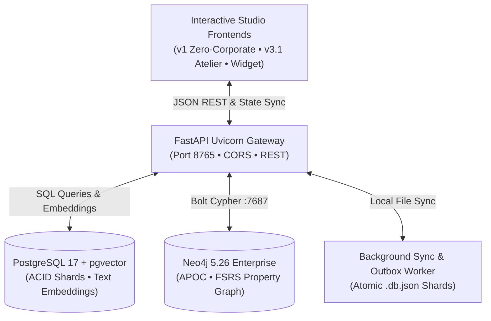
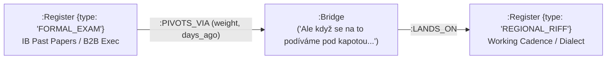
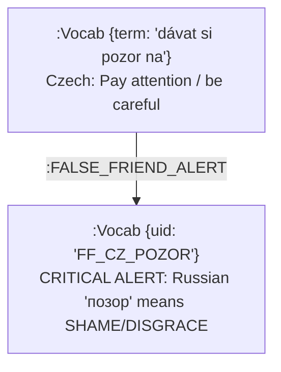

# Architecture & Flow Blueprint: Polyglot Interpersonal Riff Studio & Neo4j SRS Engine

> Persistent system documentation capturing the complete 4-layer architecture, property graph schema, conversational flow topology, and SRS memory retention mechanics.

---

## 1. System Topology Overview

---

## 2. 4-C Conversational Riff Mechanics

Every persona operates across four core communication vectors designed for status equalization and organic pacing:

| Stage | Vector Name | Core Linguistic Objective | Acoustic Prosody Rule |
| :--- | :--- | :--- | :--- |
| **Stage 1** | `COMPLIMENT` | Status-elevating validation without corporate flatter | Warm open resonance, relaxed posture |
| **Stage 2** | `CHAMELEON` | Shared operational wavelength & insider empathy | Tempo lock, conspiratorial slang mirroring |
| **Stage 3** | `COUNTERACT` | Pattern-interrupt friction resolver against hesitation | **-4 to -6 ST fundamental pitch drop (F0)** |
| **Stage 4** | `CURIOSITY` | Open-loop adventure invitation / next action | Melodic lift, forward-leaning eye contact |

---

## 3. Register Dual-Layer Topology

The graph organizes language expressions into two parallel registers bridged by `:PIVOTS_VIA` code-switching nodes:

### Supported Regional & Musical Personas

1. 🇨🇿 **Ostravian Czech (`CZ_OVA`)**
   - **Anthem:** *"Ostrava"* — Jaromír Nohavica
   - **Key Mechanics:** Clipped short vowels (*krátké zobáky*), mining Germanisms (*fachat*, *šichta*, *fajront*), Silesian causal connector (*bo* = strictly *because*).
2. 🇦🇹 **Viennese German (`AT_VIE`)**
   - **Anthem:** *"Vienna Calling"* — Falco
   - **Key Mechanics:** Syncopated waltz meter (92 BPM), status-leveling coffeehouse irony (*Wiener Schmäh*), modal stance particles (*eh*, *halt*, *ja*, *mal*).
3. 🇰🇿 **Almaty Russian (`RU_ALA`)**
   - **Anthem:** *"Джулия"* — A-Studio / Batyrkhan Shukenov
   - **Key Mechanics:** Deep chest resonance, kinship vocatives (*родной*), high-trust hospitality metaphors (*дастархан*, *сделали по красоте*).
4. 🇨🇦 **Calgary Foothills English (`EN_YYC`)**
   - **Anthem:** *"Working for the Weekend"* — Loverboy
   - **Key Mechanics:** Percussive punch (116 BPM), unpretentious gravel (*give ’er*, *all hat and no cattle*, *’69 Mustang in the garage*).
5. 🇪🇸 **Sotogrande Andaluz (`ES_SOT`)**
   - **Anthem:** *"Volando Voy"* — Camarón de la Isla
   - **Key Mechanics:** 12-beat compás pauses (104 BPM), conspiratorial subjunctive, authentic duende (*mirar los toros desde la barrera*).
6. ✨ **Global Nocturne Track (`WEEKND`)**
   - **Anthem:** *"One of the Girls"* — The Weeknd ft. JENNIE & Lily-Rose Depp
   - **Key Mechanics:** 87 BPM nocturnal synthwave, Cm7–Ebmaj7 progression, high-stakes velvet submission & devotion (*tough love*).

---

## 4. Spaced Repetition (FSRS) Memory Retention Formula

Edge mastery decays dynamically based on review intervals and stability:

$$R(t) = \left(1 + \frac{t}{9 \cdot S}\right)^{-1}$$

* $R(t)$: Probability of fluent retrieval at time $t$ (days).
* $S$: Edge stability factor (memory half-life in days).
* $t$: Elapsed time since last drill (`days_ago`).

### Telemetry Weight Colors
* **Mastered** ($w \ge 0.85$, $t < 7\text{d}$): Emerald `#34d399`
* **Active** ($0.60 \le w < 0.85$): Cyan/Indigo `#00ffcc` / `#818cf8`
* **Decaying / Rusty** ($w < 0.60$ or $t \ge 7\text{d}$): Amber `#fbbf24`

---

## 5. Trilingual False-Friend Interference Shield

To prevent linguistic interference under high pressure, warning edges `:FALSE_FRIEND_ALERT` intercept cross-lingual calques:

* `úžasný` (CZ: wonderful) $\leftrightarrow$ `ужасный` (RU: terrible/horrible)
* `čerstvý` (CZ: fresh data) $\leftrightarrow$ `черствый` (RU: stale/hard bread)
* `pozor` (CZ: attention) $\leftrightarrow$ `позор` (RU: public shame)
* `zapomenout` (CZ: forget) $\leftrightarrow$ `запомнить` (RU: remember)

