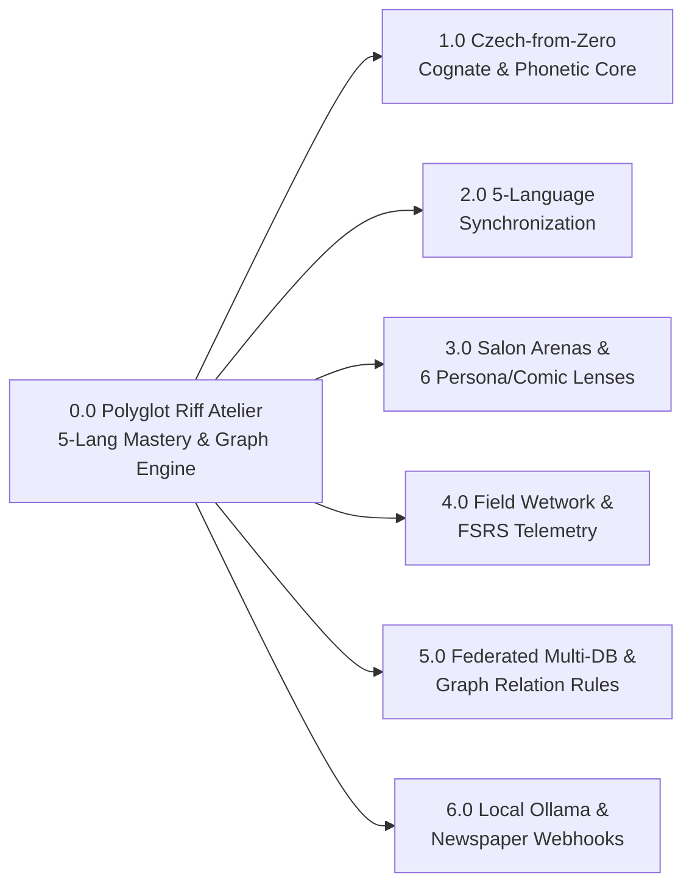

# Polyglot Riff Atelier — Checkpoint & Wetwork Sheet, WBS, and 9×9 Matrix

> **Classification:** *Streng geheim · Přísně tajné · Совершенно секретно*  
> **Operational Objective:** Strengthen all 5 regional languages (`CZ_OVA`, `AT_VIE`, `RU_ALA`, `EN_YYC`, `ES_SOT`) simultaneously while acquiring **Czech from Zero** via existing German (`DE`), Russian (`RU`), and English (`EN`) bridges—across B2B, *Fashion Zákulisí*, *Hochkultur*, and *Polo Club* rooms.

---

## 1. Work Breakdown Structure (WBS `1.0` – `6.0`) & Checkpoint Gates

| WBS ID | Work Package / Deliverable | Target DB / Module | Cadence / Effort | Checkpoint Exit Gate (Pass Criteria) | Status |
| :--- | :--- | :--- | :--- | :--- | :---: |
| **`1.0`** | **Czech-from-Zero Phonetic & Cognate Foundation** | `db/cz_ova.db.json` | Daily (8 min) | **CP-1:** Speak full 4-C `CZ_OVA` chain aloud from zero without reading phonetics | `[ ]` |
| `1.1` | First-syllable stress & clipped Ostravian vowel lock (`fachat`, `šichta`, `fajront`, `bo`, `kaj`) | Tab 1 & Tab 3 | Daily | Zero penultimate Russian stress drift on Czech words | `[ ]` |
| `1.2` | German structural calque mapping (`zaměřit se na`, `spoléhat se na`, `dávat pozor na`) | Tab 4 Shield | 3× / week | Instant recall of Czech prepositional government via German | `[ ]` |
| `1.3` | Slavic false-friend immunization (`úžasný`, `čerstvý`, `nápad`, `pozor`, `hodina`, `zapomenout`) | Tab 4 Blitz | Daily (60s) | Blitz streak $\ge 9/9$ with zero Russian homonym traps | `[ ]` |
| `1.4` | 5th-case Vocative lock (*Petře, Radku, Martine, Tomáši*) + `BR_CZ_STD_TO_OVA` pivot | Switcher Widget | Pre-call | Seamless C-Suite *Vykání* → Dev *Tykání* drop in one breath | `[x]` |
| **`2.0`** | **5-Language Core Synchronization (`CZ` • `AT` • `RU` • `EN` • `ES`)** | All 5 Lang DBs | Daily (10 min) | **CP-2:** 3× Chameleon Roulette runs with clean `:PIVOTS_VIA` switches | `[ ]` |
| `2.1` | `AT_VIE` *Wiener Schmäh* modal particles (`eh`, `halt`, `ja`, `wohl`) & *Kaffeehaus* cadence | `db/at_vie.db.json` | 3× / week | Stretch vowels warmly on understatement (`schwer in Ordnung`) | `[ ]` |
| `2.2` | `RU_ALA` Almaty kinship warmth (`родной`, `по красоте`, `базару нет`) & chest resonance | `db/ru_ala.db.json` | 3× / week | Zero corporate stiffness; grounded Southern Capital warmth | `[ ]` |
| `2.3` | `EN_YYC` Foothills punch + `ES_SOT` Sotogrande *duende* & conspiratorial subjunctive | `en_yyc` / `es_sot` | 3× / week | Clean rhythmic contrast between monosyllabic `EN_YYC` & melodic `ES_SOT` | `[ ]` |
| `2.4` | Cross-language `:SHARES_VIBE_WITH` etymological & vibe cousin traversal | `polyglot_fabric` | Weekly | Recall cross-language cousin for all 15+ core idioms | `[x]` |
| **`3.0`** | **High-Society Salons (`Fashion` • `Hochkultur` • `Polo`) & 6 Persona Lenses** | Tab 3 Salon | 4× / week | **CP-3:** Model any arena phrase in 2 contrasting lenses across all 5 langs | `[x]` |
| `3.1` | *Fashion Runway & Zákulisí* 5-language deck (`navoněná bída`, `sedcard`, `na první dobrou`) | Tab 3 (`runway`) | Built & Live | Deliver backstage vs. spotlight contrast across all 5 personas | `[x]` |
| `3.2` | *Staatsoper & Hochkultur* + *Polo Club & Paddock* 5-language decks (`Pflanzerei`, `buena muñeca`) | Tab 3 (`hoch`/`polo`) | Built & Live | Disarm salon formality with local-positive craft appreciation | `[x]` |
| `3.3` | 3 Local Salon Lenses (`Deadpan Flâneur`, `Silk-Gloved Alchemist`, `Backstage Raconteur`) | `COMIC_STYLES` 1–3 | Built & Live | Distinct prosodic pause & cadence per lens | `[x]` |
| `3.4` | 3 Added Comic Models (`Craig Ferguson`, `Patrice O'Neal`, `Robin Williams`) | `COMIC_STYLES` 4–6 | Built & Live | Cue-card rip, half-octave chest warmth, and polyglot spark on demand | `[x]` |
| **`4.0`** | **Field Wetwork Execution & FSRS Spaced-Repetition Telemetry** | Tab 1 & Tab 2 | Daily (27 min) | **CP-4:** Avg Mastery $\ge 85\%$ & Rusty Queue $= 0$ edges $< 75\%$ | `[ ]` |
| `4.1` | 1-Hop `:COUNTERS_STATE` reflex routing (`MANUAL_GRIND`, `CORPORATE_SHIELD`, `OVERTHINKING`, `SAFE`) | Tab 1 Resolver | Pre-call | Sub-2-second vocal pivot when counterpart stalls or shields up | `[ ]` |
| `4.2` | FSRS stability $S$ & retrievability $R(t) = (1 + t / (9S))^{-1}$ patina upkeep | Tab 2 Force-Graph | Daily | Drill every amber dashed edge back above $R \ge 85\%$ | `[ ]` |
| `4.3` | *Station Wien* 27-minute zero-English wetwork protocol (7 timed phases) | Wetwork Sheet | Daily morning | Complete all 7 phases without speaking a word of English | `[ ]` |
| **`5.0`** | **Federated Per-Language Databases & Graph Relation Governance** | `/db/*.db.json` | Built & Live | **CP-5:** 4/4 Graph Relation Rules pass on every node/edge commit | `[x]` |
| `5.1` | 5 per-language shards (`cz_ova` unified `CZ_OVA+CZ_STD`, `at_vie`, `ru_ala`, `en_yyc`, `es_sot`) + `fabric` | `c:\Assets\PolyglotSales\db\` | Built & Live | Clean partition boundaries & 1-click `.db.json` / `.cypher` export | `[x]` |
| `5.2` | Strict Graph Relation Validator (`:HAS_CARD`, 4-C sequence, `:INJECTS_SLANG`, `:SHARES_VIBE_WITH`) | `graph_relation_validator.js` | Built & Live | Zero invalid edges or unanchored slang spans | `[x]` |
| **`6.0`** | **Local Ollama Synthesis & Regional Newspaper Webhook Pipeline** | Tab 5 Workbench | Weekly harvest | **CP-6:** +1 newspaper-sourced regional saying per language / week | `[ ]` |
| `6.1` | Local Ollama (`localhost:11434/api/chat`) structured JSON idiom + card generator + offline fallback | Tab 5 Ollama | Built & Live | One-click synthesis & validation into target language DB | `[x]` |
| `6.2` | Staged Regional Newspaper Webhook Queue (*Patriot*, *Falter*, *Europa Sur*, *Tengrinews*) | Tab 5 Webhooks | Staged & Live | Review & approve staged dispatches into active rotation | `[x]` |
| `6.3` | Automated background RSS/Webhook listener daemon writing to `db/polyglot_fabric.db.json` | Future Phase | Planned | Scheduled local script fetching live regional columns | `[ ]` |

---

## 2. Wetwork Field-Ops Sheet (*Station Wien · Zákulisí · Paddock*)

### 2.1 Operational Cover Identities (*Legende · Legenda · Легенда*)
Never translate yourself word-for-word from English—step into each regional person's posture and vocal placement:

| Code | Cover Persona (*Legende*) | Vocal Placement & Posture | Signature Anchor Tokens |
| :--- | :--- | :--- | :--- |
| **`CZ_OVA`** | **The Ostrava Chief Builder in the VIP Box** *(Learned from Zero via DE/RU)* | Forearms grounded, crisp first-syllable stress, clipped short vowels, zero corporate fluff. | `fachat` · `šichta` · `fajront` · `bo` · `kaj` · `na první dobrou` |
| **`AT_VIE`** | **The Unhurried Staatsoper & Kaffeehaus Regular** | Lean back 10 degrees, crooked grin, waltz vowel stretch, velvet irony. | `schwer in Ordnung` · `eh / halt` · `an der Garderobe abgeben` · `Pflanzerei` |
| **`RU_ALA`** | **The Almaty Upper-Terrace Host** | Open chest, warm low resonance, generous hospitality + decisive clarity. | `родной` · `сделали по красоте` · `базару нет` · `без лишних понтов` |
| **`EN_YYC`** | **The Foothills Backstage Straight-Shooter** | Relaxed shoulders, accomplice half-smirk, percussive monosyllabic punch. | `bud` · `all hat and no cattle` · `69 Mustang collecting dust` |
| **`ES_SOT`** | **The Sotogrande Paddock & Marina Insider** | Expressive hands, rapid melodic burst → sun-soaked dramatic pause. | `tiene duende` · `tener buena muñeca` · `mirar los toros desde la barrera` |

### 2.2 Daily 27-Minute Wetwork Protocol (Run in Order — Zero English Spoken After `03:00`)
- `[ ]` **Checkpoint Alpha (`00:00–03:00`) — Posture & Resonance Boot:** Drop half an octave into chest resonance; read the 4 `CZ_OVA` phonetic lines aloud using the `DE`/`RU` cognate bridge.
- `[ ]` **Checkpoint Beta (`03:00–07:00`) — C-Suite → Ostrava Register Drop:** Run `CZ_STD_COMP_01` → `BR_CZ_STD_TO_OVA` → `CZ_OVA_COUNT_01` (*"odložíme kravaty..."*) with 5th-case Vocative (*Petře / Martine*).
- `[ ]` **Checkpoint Gamma (`07:00–11:00`) — Trilingual Interference Shield:** Run Tab 4 Blitz until you hit a 9/9 streak (`úžasný ≠ ужасный`, `čerstvý ≠ черствый`, `zapomenout ≠ запомнить`).
- `[ ]` **Checkpoint Delta (`11:00–16:00`) — 5-Language Salon Sweep:** Pick one Salon (`Runway`, `Hochkultur`, or `Polo`) in Tab 3 and speak all 5 language cards aloud back-to-back.
- `[ ]` **Checkpoint Epsilon (`16:00–20:00`) — Comic Lens Remodel:** Re-deliver the same 5 cards switching from a Local Salon lens (*Velvet Deadpan*) to a Comic lens (*Craig Ferguson*, *Patrice O'Neal*, or *Robin Williams*).
- `[ ]` **Checkpoint Zeta (`20:00–24:00`) — Live Objection Ambush:** Hit all 4 `:COUNTERS_STATE` hotkeys in Tab 1 (`MANUAL_GRIND`, `CORPORATE_SHIELD`, `OVERTHINKING`, `PLAYING_IT_SAFE`) eyes-up.
- `[ ]` **Checkpoint Eta (`24:00–27:00`) — Chameleon Roulette & FSRS Log:** Spin `🎲 4-C Mashup`, execute the mid-sentence `:Bridge`, and grade rusty edges in Tab 1/Tab 2.

---

## 3. The 9×9 Matrices

### 3.1 Matrix A: 9×9 Tactical Wetwork Cross-Matrix (9 High-Stakes Rooms × 9 Execution Columns)

| # | Room / Checkpoint | 1. `🇨🇿 CZ_OVA` (+ DE/RU Bridge) | 2. `🇦🇹 AT_VIE` | 3. `🇰🇿 RU_ALA` | 4. `🇨🇦 EN_YYC` | 5. `🇪🇸 ES_SOT` | 6. 4-C Stage | 7. Optimal Lens | 8. Acoustic Cue | 9. Exit Gate |
| :-: | :--- | :--- | :--- | :--- | :--- | :--- | :--- | :--- | :--- | :--- |
| **1** | **Cold Spark (First 15s)** | `klobouk dolů` *(DE: Hut ab)* | `schwer in Ordnung` | `сделали по красоте` | `real deal, bud` | `tiene duende` | `1. COMPLIMENT` | `🎭 Deadpan Flâneur` | Calm 1.5s pause, zero eagerness | Guard drops; genuine smile |
| **2** | **C-Suite Boardroom** | `škálujete exekuci` *(Vykání + Vocative)* | `Substanz mit Schmäh` | `чувствуется масштаб` | `built an engine` | `cartas sobre la mesa` | `1→2 COMP/CHAM` | `⚡ Silk-Gloved` | Measured pace, precise vowels | Executive nods in alignment |
| **3** | **Dev Trench Handoff** | `odložíme kravaty → fachat` *(DE: Fach)* | `kein G’schichtldrucken` | `базару нет, одной крови` | `crank amp to 11` | `en la misma onda` | `:PIVOTS_VIA` | `🔥 Raconteur` | Lean forearms on table, clip vowels | Engineers lean in as peers |
| **4** | **Fashion Runway (`Zákulisí`)** | `žádná navoněná bída, střih drží` *(RU: за кулисами)* | `ohne lautes Theater` | `видно руку мастера` | `zero runway pose` | `el corte real` | `1. COMPLIMENT` | `🎩 Craig Ferguson` | Cheeky aside past the spotlight | Instant backstage insider rapport |
| **5** | **Staatsoper `Hochkultur`** | `základ drží → klidný fajront` *(DE: Feierabend)* | `an der Garderobe abgeben` | `живая энергия за искусством` | `take it out from chandeliers` | `hablar claro en el salón` | `2→3 CHAM/COUNT` | `🎭 Deadpan Flâneur` | Sip pause, flat `-3st` contour | Pretension melts into candor |
| **6** | **Polo Club Paddock** | `kaj je síla v tahu` *(DE: Zugkraft)* | `Ruhe im Sattel` | `порода и размах` | `knows real horses` | `tener buena muñeca` | `1→4 COMP/CUR` | `🌪️ Robin Williams` | Aristocratic setup → pit-crew spark | Shared laugh at the rail |
| **7** | **Station Wien Café** | `čerstvá a přesná data` *(Shield active)* | `kein großes Tam-Tam` | `с полуслова` | `where rubber meets gravel` | `ir al grano con arte` | `:SHARES_VIBE` | `⚡ Silk-Gloved` | Seamless 3-lang switch, zero EN | Zero lexical interference |
| **8** | **Room-Friction Stall** | `zbytečná šichta, bo...` *(DE: Schicht)* | `nette Pflanzerei` | `беркут в золотой клетке` | `69 Mustang collecting dust` | `toros desde la barrera` | `3. COUNTERACT` | `🦁 Patrice O'Neal` | Half-octave chest drop, 20% slower | Counterpart drops stall excuse |
| **9** | **Next-Day Open Loop** | `hoď na to oko, sfoukneme to` | `schönster Bledsinn als Nächstes?` | `рвануть наверх на Медеу?` | `kick the garage doors open?` | `mójate conmigo: ¿qué jugada?` | `4. CURIOSITY` | `🎩 Craig Ferguson` | Upbeat accomplice grin, stop talking | Counterpart books next step |

---

### 3.2 Matrix B: `9 × 9 · Polyglot Atelier Salesact` (Lotus / Mandalart 81-Cell Map)

**Every persona, phrase, bridge & graph build, one map**  
Lotus layout for the Sales Polyglot Atelier: the centre block names eight themes around **`Polyglot Atelier Salesact`**; each theme is the centre of its own block with eight tactics, phrases, bridges, or builds. `1–4` anchor the five regional tongues (acquiring `CZ_OVA` from zero via `DE`/`RU`/`EN`), `5` routes 4-C flows, `:PIVOTS_VIA` bridges, and `:COUNTERS_STATE` interrupts, `6` models phrases through 3 local salon styles + 3 comics (Ferguson, O’Neal, Williams), `7` runs *Fashion / Hochkultur / Polo* salons and *Station Wien* wetwork, and `8` powers federated per-language DBs, FSRS patina, local Ollama, and staged newspaper webhooks.

> *Interactive clickable `Polyglot Atelier Salesact` 9×9 Lotus grid (with Lotus radiation filter, cell/connector inspector, and 27m Wetwork timer) is live in **Tab 6 (`6. Checkpoint • Wetwork • 9×9`)** of [polyglot_riff_studio_v3_1_atelier_edition.html](file:///c:/Assets/PolyglotSales/polyglot_riff_studio_v3_1_atelier_edition.html).*

| Col 1 | Col 2 | Col 3 | Col 4 | Col 5 | Col 6 | Col 7 | Col 8 | Col 9 |
| :---: | :---: | :---: | :---: | :---: | :---: | :---: | :---: | :---: |
| 1st-Syllable Stress Lock | `fachat · šichta · fajront` | `bo & kaj` Silesian Reflex | Modal `eh · halt · wohl` | Waltz Vowel Stretch | `schwer in Ordnung` | Kinship `родной · брат` | `сделали по красоте` | `базару нет` Alignment |
| 5th-Case Vocative Lock | **`1 · CZ_OVA From Zero`** | `DE` Preposition Calques | `Garderobe` Coat-Check | **`2 · AT_VIE Schmäh`** | `G’schichtldrucken` Cut | Golden Eagle Metaphor | **`3 · RU_ALA Insider`** | `без лишних понтов` |
| 9/9 `RU` False-Friend Shield | `CZ_STD → CZ_OVA` Drop | `DE/RU` Cognate Shadowing | `Pflanzerei` Salon Wit | `kein großes Tam-Tam` | 10° Lean & Wry Pause | Dastarkhan Warmth | Medeu Altitude Hook | `с полуслова` Resonance |
| Foothills `bud` Hook | `all hat and no cattle` | `69 Mustang` Counter | **`1 · CZ_OVA From Zero`** | **`2 · AT_VIE Schmäh`** | **`3 · RU_ALA Insider`** | `1. COMPLIMENT` Opener | `2. CHAMELEON` Mirror | `3. COUNTERACT` Pivot |
| `tiene duende` Soul | **`4 · EN_YYC & ES_SOT`** | `mirar los toros` | **`4 · EN_YYC & ES_SOT`** | **`Polyglot Atelier Salesact`** | **`5 · 4-C & Bridges`** | `4. CURIOSITY` Open Loop | **`5 · 4-C & Bridges`** | `:COUNTERS_STATE < 2s` |
| `tener buena muñeca` | `BR_YYC_SOT :PIVOTS_VIA` | Subjunctive `mójate` | **`6 · 6 Persona Lenses`** | **`7 · Salons & Wetwork`** | **`8 · Multi-DB & AI`** | `:PIVOTS_VIA` 4 Bridges | `:SHARES_VIBE` Cousins | Chameleon 4-C Roulette |
| `🎭` Deadpan Flâneur | `⚡` Silk-Gloved Alchemist | `🔥` Backstage Raconteur | Fashion `Zákulisí` 5× | Staatsoper `Hochkultur` | Polo Club Paddock 5× | `db/cz_ova` Shared Core | 5 Isolated Lang Shards | 4/4 Graph Rule Gate |
| `🎩` Craig Ferguson | **`6 · 6 Persona Lenses`** | `🦁` Patrice O’Neal | 27m Station Wien | **`7 · Salons & Wetwork`** | 5 Cover *Legenden* | FSRS $R(t) \ge 85\%$ Patina | **`8 · Multi-DB & AI`** | Disk JSON Auto-Sync |
| `🌪️` Robin Williams | Half-Octave Chest Drop | 1.5s Appreciative Pause | Zero-English After 03:00 | 9-Room Tactical Sheet | `CP-1..CP-6` Exit Gates | Ollama `:11434` Synth | Newspaper Webhook Queue | Neo4j `.cypher` Migration |

**Key:** `1` `CZ_OVA` Czech-from-Zero (shared `CZ_OVA + CZ_STD`) · `2` `AT_VIE` Wiener Schmäh · `3` `RU_ALA` Almaty Insider · `4` `EN_YYC` Calgary Flair & `ES_SOT` Sotogrande Duende · `5` 4-C flow, `:PIVOTS_VIA` bridges & `:COUNTERS_STATE` resolver · `6` 3 local-positive salon styles + 3 comic lenses · `7` *Fashion Zákulisí*, *Hochkultur*, *Polo Club* & 27m *Station Wien* wetwork · `8` federated `/db/*.db.json`, 4/4 graph relation rules, FSRS, Ollama & newspaper webhooks.  
**Rules every cell obeys:** local-positive warmth (celebrate real makers, never punch down), `CZ_OVA + CZ_STD` share one primary DB bridged from zero via `DE`/`RU`/`EN`, zero English spoken after minute `03:00` in wetwork, every new card passes 4/4 Graph Relation Rules (`:HAS_CARD`, 4-C stage, `:INJECTS_SLANG`, `:SHARES_VIBE_WITH`), newspaper webhooks stage before graph commit.

